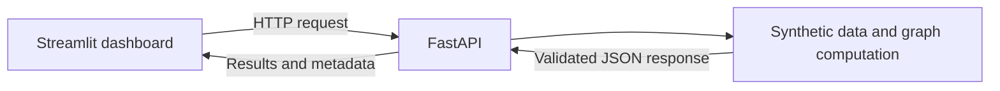

# Graph-Based Portfolio API & Deployment System

This project implements a local model-serving and deployment workflow around a synthetic graph-based portfolio simulation. It combines a FastAPI service, a Streamlit dashboard, Docker containers, and an interactive engineering guide. This repository includes the executable synthetic-demo source code; the original Factor GCN research code, trained weights, and financial datasets are not included.

**[Read the interactive project guide](https://rozias0925.github.io/FY26-Portfolio-Deploy/)**

## Project purpose

The project develops the engineering layer around a computational model: input validation, service boundaries, result presentation, container configuration, and reproducible verification. It accompanies my [Factor GCN research project](https://rozias0925.github.io/FY26-Graph-Portfolio/) while using a separate, transparent synthetic pipeline for the implementation.

The guide contains nine chapters and a bilingual technical glossary. Its main text is in Traditional Chinese; this README provides an English overview of the system and its evidence.

## Implementation

| Component | Implementation |
| --- | --- |
| Computation | Seeded synthetic data, correlation-based graph construction, fixed-rule message propagation, and allocation evaluation |
| API | FastAPI endpoints with strict Pydantic request and response contracts |
| Dashboard | Streamlit interface for scenario selection, parameter submission, charts, graph explanation, and JSON inspection |
| Deployment | Separate API and dashboard Dockerfiles, Compose health checks, non-root containers, and loopback host ports |
| Verification | Model, API, HTTP integration, dashboard, launcher, and deployment-policy tests |
| Project guide | Static HTML/CSS/JavaScript site with architecture explanations, source excerpts, saved execution evidence, and a browser-only illustration |



The static guide runs independently of this Python stack. Its JavaScript illustration and the saved Python execution records are labelled separately.

## Recorded verification

The latest full source verification was recorded on **13 November 2026**, for project version **1.1.2**.

| Check | Recorded result | Evidence |
| --- | --- | --- |
| Python tests | 141 passed; 1 deprecation warning | [Test output](docs/evidence/pytest.txt) |
| Website structure and assets | 32 passed | [Website checks](docs/evidence/website-contract.txt) |
| Container HTTP checks | 12 passed | [HTTP record](docs/evidence/docker-http-20261113.json) |
| Dashboard browser interactions | 6 passed | [UI record](docs/evidence/docker-dashboard-ui-20261113.json) |

Python verification used Windows / CPython 3.12.14; the Docker run used Linux / CPython 3.12.16. Container images were built, then their source hashes and image IDs were checked before reuse in the final runtime verification. The recorded run includes cleanup of its containers and network, followed by Docker Desktop shutdown.

These are dated execution records. [Verification details](docs/testing.md), the [machine-readable report](docs/evidence/verification.json), and the [source manifest](docs/evidence/source-manifest.json) define their scope. The API and synthetic model retain version **1.0.0**, independently of the project version.

## Run locally

### Read the guide

Open [`web/index.html`](web/index.html) from a local checkout. The chapters, glossary, saved results, and browser illustration work with the Python services stopped.

### Start the Python system

The verified native setup is **Windows PowerShell with CPython 3.12.x**. Node.js is required for the website checks. Use a fresh virtual-environment directory:

```powershell
py -3.12 -m venv .venv-repro
.\.venv-repro\Scripts\python.exe -m pip install -r requirements.txt
.\.venv-repro\Scripts\python.exe scripts/run_local.py
```

The launcher uses ports **8000**, **8501**, and **8080**, and exits if any required port is occupied. Once it reports readiness:

- API explorer: `http://127.0.0.1:8000/docs`
- Streamlit dashboard: `http://127.0.0.1:8501`
- Project guide: `http://127.0.0.1:8080`

Press **Ctrl+C** in the launcher terminal to stop the processes it created. Detailed setup, Docker verification, and shutdown instructions are in the [local reproduction guide](docs/LOCAL_REPRODUCTION.md).

### Run checks

```powershell
.\.venv-repro\Scripts\python.exe -m pytest -q
node scripts/check_web.mjs
```

`scripts/verify.py` generates a fresh dated report and updates the saved verification artifacts. Docker runtime verification is a separate operation through `scripts/verify_docker.py`.

## Synthetic computation

Each scenario generates six fictional assets with 180 observations. The first 120 observations determine summary statistics, graph edges, and allocation weights; the remaining 60 evaluate the fixed allocation. A seeded generator makes comparable runs reproducible.

The graph uses thresholded absolute correlations. A single fixed-rule propagation step combines each asset's signal with its neighbours, followed by a volatility adjustment and normalized allocation weights. This is a deterministic engineering example with fixed parameters, rather than a trained GCN. The [architecture document](docs/architecture.md) specifies the formulas, API contract, and evaluation assumptions.

A typical `POST /simulate` request is:

```json
{
  "scenario_id": "scenario_a",
  "seed": 42,
  "risk_level": "balanced"
}
```

Responses contain allocations, metrics, an equity curve, graph data, and metadata identifying the synthetic model and input parameters. The dashboard marks previous results when controls change, keeping displayed outputs tied to the request that produced them.

## Repository structure

```text
backend/app/       FastAPI routes, schemas, and service layer
demo/             Synthetic generator and graph computation
dashboard/        Streamlit HTTP client and interface
web/              Static project guide and browser illustration
tests/            Computation, service, interface, and deployment tests
scripts/          Launch, verification, evidence export, and preview tools
private_adapters/ Abstract interface for potential future research integration
docs/             Architecture, reproduction, limitations, and selected evidence
```

## Scope and limitations

The project demonstrates local software engineering with synthetic data. Its evaluation assumes the same target weights each day and omits transaction costs, liquidity, market impact, and trade execution. Synthetic metrics establish the behaviour of the example, rather than financial forecasting performance.

API and dashboard access is configured for local use. Compose binds host ports to `127.0.0.1`; its project bridge permits outbound container connections. The GitHub Pages website serves the static guide, saved execution records, and browser illustration. The Python services run locally.

The author has not selected an open-source license. Third-party dependencies remain subject to their respective terms; see the [dependency and licensing review](docs/THIRD_PARTY_LICENSES.md). The example is for educational and technical demonstration, with synthetic data and no investment-advice service.

## Further documentation

- [Architecture and API contract](docs/architecture.md)
- [Local reproduction guide](docs/LOCAL_REPRODUCTION.md)
- [Verification records](docs/testing.md)
- [Technical limitations](docs/LIMITATIONS.md)
- [Data and research boundaries](docs/DATA_POLICY.md)
- [Repository snapshot scope](docs/GITHUB_UPLOAD_20261114.md)
