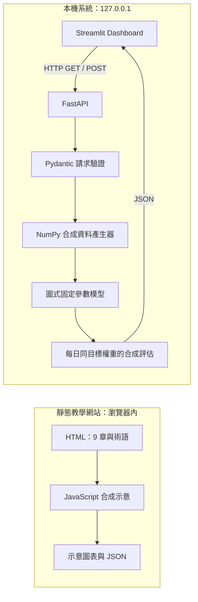

# 工程架構與可驗證的資料流程

本專題把研究程式「封裝成可呼叫、可檢查的服務」作為教學目標。實際運算為自行產生合成資料的固定參數圖式示範，識別名稱是 `demo_synthetic_graph_model`。原始 Factor GCN 為 **NOT INTEGRATED**；沒有讀取研究資料、已訓練權重或原研究程式。

## 兩個入口，各有自己的執行方式



靜態網站可由本機靜態檔案服務開啟；它不呼叫 Python API。Dashboard 是另一個 Python 程式，只負責組合 HTTP 請求與畫圖。它不匯入 `demo/`，因此不會悄悄以另一套模型計算取代後端。兩個入口的示例不代表原始 Factor GCN 實驗。

公開發布狀態是 **PENDING REVIEW**。圖中的「靜態」描述可獨立運作的技術性質，不表示已獲准公開。

## 一次請求如何通過系統

1. 使用者在 `dashboard/app.py` 選擇 `scenario_a`、種子 `42` 與 `balanced`。
2. Dashboard 送出 `POST /simulate`，Body 是 JSON。
3. `backend/app/schemas.py` 限制情境 ID、嚴格整數種子與可用的風險參數；未知欄位也會被拒絕。
4. 後端服務呼叫合成 pipeline。`demo/synthetic_data.py` 產生 6 個虛構資產、180 個觀測日。
5. `demo/graph_demo_model.py` 只用前 120 日建圖與建立配置，再以後 60 日計算結果。
6. FastAPI 回傳 allocations、metrics、equity_curve、graph、metadata 與 explainability。
7. Dashboard 從 JSON 建立表格與圖表。改變控制項後，舊結果會明確標示為「上一次成功結果」；新請求失敗也不會把舊資料說成新結果。

## API 契約

| Endpoint | 方法 | 用途 | 關鍵回應欄位 |
|---|---|---|---|
| `/health` | GET | 確認服務就緒 | `status`, `version`, `data_mode`, `investment_advice` |
| `/model-info` | GET | 說明模型身分與限制 | `model_id`, `model_version`, `trained_model: false`, `original_factor_gcn: "NOT INTEGRATED"` |
| `/scenarios` | GET | 取得允許的控制項 | `scenarios`, `allowed_parameters` |
| `/simulate` | POST | 執行合成 pipeline | `allocations`, `metrics`, `equity_curve`, `graph`, `metadata`, `explainability` |
| `/docs` | GET | 本機互動 API 文件 | 自製 API explorer，資源在本機，不使用 Swagger CDN |

```json
{
  "scenario_id": "scenario_a",
  "seed": 42,
  "risk_level": "balanced"
}
```

允許的情境是 `scenario_a`、`scenario_b`、`scenario_c`；風險參數是 `low`、`balanced`、`high`；種子為 `0` 到 `2147483647` 的嚴格整數。沒有 ticker、URL、檔案路徑、使用者資產資料或模型檔案的輸入欄位。

每個 `/simulate` 回應的 `metadata` 都必須包含 `data_mode: "synthetic"`、`investment_advice: false` 與 `original_factor_gcn: "NOT INTEGRATED"`。其他三個資料端點在頂層帶有合成資料與非投資建議標籤。

有效請求通常回傳 HTTP 200；參數錯誤回傳 422；非預期運算失敗回傳通用 500 訊息。422 不包含原始輸入值或內部 context；500 不公開 traceback。Dashboard 連線逾時為 8 秒，僅呈現一般錯誤，不在訊息中回印請求或環境設定。UI 的 API 位址只接受 loopback 或 Compose 的 `api` 名稱；不繼承環境代理，也不跟隨 HTTP 重新導向，避免將本機請求轉到外部。

## 合成圖模型的運算

令 `R_train` 是前 120 個合成日報酬，矩陣有 6 欄，每欄為一個虛構資產。以下所有統計都來自這個區段；後 60 日只用來評估固定配置。

1. **建圖（Graph Construction）**：計算欄位間 Pearson 相關矩陣 `C = corr(R_train)`。若 `i != j` 且 `abs(C[i,j]) >= 0.25`，邊權重 `A[i,j] = abs(C[i,j])`；否則為 0。
2. **加入自身並正規化**：`A_tilde = A + I`。將每一列除以該列總和，得到 `P`。因此 `P @ s` 是每個節點對自己與相連節點訊號的加權平均。
3. **特徵與圖傳播**：`s = mean(R_train) / sample_std(R_train) * sqrt(252)`；`z = 0.5 * s + 0.5 * P @ s`。這是一層固定參數的訊息混合，沒有神經網路訓練。
4. **波動懲罰**：以每個資產的訓練波動 `vol` 計算 `logits = (z - penalty * vol / mean(vol)) / temperature`。
5. **形成權重**：`weights = (1 - concentration) / 6 + concentration * softmax(logits)`。softmax 將分數轉成正數並使總和為 1；與均分配置混合可避免全部權重集中在單一節點。

| `risk_level` | `penalty` 波動懲罰 | `temperature` 溫度 | `concentration` 集中度混合 |
|---|---:|---:|---:|
| `low` | 1.5 | 1.5 | 0.35 |
| `balanced` | 0.75 | 0.9 | 0.65 |
| `high` | 0.15 | 0.5 | 0.9 |

這些標籤確實改變運算，但不保證每次樣本的實現波動、回落或收益都按照名稱排序。沒有學習參數、checkpoint、因子 GCN 實驗、超參數搜尋或模型有效性的證據。圖使用相關的**絕對值**，因此正負關係都可能連邊；這是為了可解釋的工程示範，不能當成金融建模定論。

## 結果指標的意思

以同一組目標配置 `w` 對後 60 日合成報酬 `R_test` 計算組合日變化 `r = R_test @ w`。曲線起點為 1，後續依序乘上 `1 + r[t]`。這代表每日按相同目標權重計算，隱含每日權重重設；不是買入後讓持倉權重自然漂移。沒有模擬再平衡執行、周轉率與成本。

| 欄位 | 計算 | 讀法與限制 |
|---|---|---|
| `cumulative_return` | `prod(1+r)-1` | 這 60 個合成日的累積變化 |
| `annualized_volatility` | `sample_std(r) * sqrt(252)` | 把樣本波動按 252 日慣例縮放；不是一年實測 |
| `sharpe_ratio` | `mean(r)/sample_std(r)*sqrt(252)` | 假設無風險利率為 0 的合成統計 |
| `max_drawdown` | `1-min(equity/running_peak)` | 正數表示自先前最高點的最大跌幅 |
| `evaluation_days` | `60` | 用於評估的合成觀測日數 |

不含交易成本、流動性、市場衝擊或真實可交易性。Scenario B 刻意與同 seed 的 Scenario A 共用前 120 日，改變後 60 日分布；配置因此相同但結果可以不同。合成生成規則本身會決定可見模式；漂亮的指標不證明模型能運用於市場。

## Docker 與網路邊界

`Dockerfile.api` 定義 API 執行環境；`Dockerfile.ui` 定義介面環境；`compose.yaml` 組合兩個服務。在 Compose 內，Dashboard 使用 `API_BASE_URL=http://api:8000`，因為容器中的 `localhost` 指向該容器自己。使用者瀏覽器仍透過主機的 `http://127.0.0.1:8501` 操作。

容器內服務可以監聽 `0.0.0.0`，但主機映射必須限制為 `127.0.0.1`。`0.0.0.0` 是所有介面，不能用在本專題的主機公開連接埠。Compose healthcheck 協助判斷服務是否就緒；它不能證明所有功能或法律權利已驗證。

本機部署是把服務放到自己的電腦執行，沒有建立雲端主機、公開 API、帳號系統或交易服務。容器建置與完整執行是否已測過，請看實際的 [testing.md](testing.md) 和交付報告；本文件的指令不是通過證據。

## 延伸閱讀與原始碼

- [從零操作 walkthrough](walkthrough.md)
- [專有名詞 glossary](glossary.md)
- [資料政策](DATA_POLICY.md) 與 [技術限制](LIMITATIONS.md)
- [人工發布關卡](RELEASE_CHECKLIST.md)

可選的 `private_adapters/` 僅提供介面邊界。即使未來有原研究檔案，仍必須先完成權利與資料審查，再另行規劃私有整合；目前沒有任何整合成果可宣稱。
